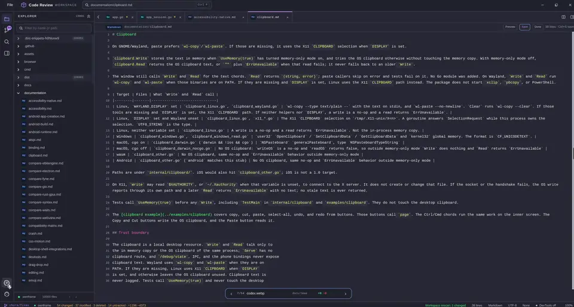

# own-code

own-code is a desktop app for reading code and reviewing diffs: explorer, in-place editor, unified and split diffs, git history, Markdown preview, and six color themes.



A quick tour: explorer, editor, Source Control diff, and history.

## Run

The entry point is `cmd/own-code/main.go`. App code lives in `internal/app/` (app core), `internal/edit/` (text buffer + selection model), and `internal/wsl/` (WSL path/handoff helpers). The embedded `components/`, `fixtures/`, and `testdata/` trees live at the repo root and are served via the root `owncode` package (`assets.go`). `go.mod`, `docs/`, `install.sh`, and this file stay at the root. Builds resolve `ownframe` through the `../ownframe` sibling checkout in `go.mod`; `vendor/` is local-only and never committed.

You need Go 1.26 and a sibling `ownframe` checkout for the local `replace`.

```sh
cd /home/chinmay/ChinmayPersonalProjects/own-code
go mod tidy
go run ./cmd/own-code
```

Point it at another directory:

```sh
go run ./cmd/own-code -root /path/to/repo
go run ./cmd/own-code -root /path/to/monorepo -files 25000
```

Useful flags:

```sh
go run ./cmd/own-code -web
go run ./cmd/own-code -web -addr 127.0.0.1:8145
go run ./cmd/own-code -dev
go run ./cmd/own-code -perf=false
go run ./cmd/own-code -chrome=false
```

The viewer opens the current directory by default and reads the working tree diff at startup. The default window is 1500x900 with a minimum of 840x700. `F12` opens the developer dock. The scan stops at 10,000 files unless `-files` raises the budget, and the status bar reports when the limit hits. `testdata/sample` (embedded via root `owncode.SampleFiles`) is the deterministic fixture the tests use. `-web` serves the same tick, key, wheel, click, and live frame loop in a browser. It does not start the file watcher.

On Windows, a workspace under a WSL network path (`\\wsl$\...`) hands off into WSL through `wsl.exe` with a translated path, so scanning, git, and watching run on Linux. `-wsl=false` forces the native Windows build. The WSL detect, path, and re-exec helpers live in `internal/wsl/` and are wired from `cmd/own-code/main.go`.

## Install

```sh
curl -fsSL https://raw.githubusercontent.com/chinmay-sawant/own-code/master/install.sh | sh
```

This builds from source and installs the binary to `$HOME/.local/bin/own-code`. To choose another prefix (the binary goes to `$PREFIX/bin`):

```sh
PREFIX=/usr/local curl -fsSL https://raw.githubusercontent.com/chinmay-sawant/own-code/master/install.sh | sh
```

Manual alternative (run it next to an `ownframe` checkout, since `go.mod`
points at `../ownframe`):

```sh
git clone https://github.com/chinmay-sawant/own-code.git
git clone https://github.com/chinmay-sawant/ownframe.git
cd own-code
go build -o own-code ./cmd/own-code
```

## Features

- Explorer tree with filter, language badges, change letters, and sticky folders. Right click gives Copy Path, Copy File, Paste.
- Up to eight tabs plus a split second editor group. Both groups share one window and one page scroll.
- Click to edit in place with syntax colors, `Ctrl+S` saves. `Ctrl+A` select all, `Ctrl+C` copy, undo and redo.
- Gutter marks on changed lines with line cards, plus a bottom bar to step through changed files.
- Unified and split diffs with word emphasis, hunk stepping (`N`/`P`), and per-block revert.
- Source Control: working tree plus a history lane graph that loads in pages. Branch picker without changing checkout.
- Quick open (`Ctrl+P`), in-file find (`Ctrl+F`), workspace content search (`Ctrl+Shift+F`).
- Markdown preview (`Ctrl+Shift+V`) with tables and Mermaid flowcharts, in fixed rows.
- Highlighting for Go, Python, JavaScript/TypeScript, Markdown, CSS, JSON, HTML, YAML, and shell.
- Details drawer with outline, status bar, persisted sessions, soft wrap (`Z`), desktop file watcher.

## Versus VS Code

VS Code is a general IDE and plugin host on Electron. own-code is a single-purpose reader and review tool.

| | VS Code | own-code |
|---|---|---|
| **Runtime** | Electron shell with 15+ helper processes | One static Go binary, no runtime to install |
| **Idle memory** | ~1,166–1,440 MB RSS across those processes | ~200 MB RSS, one process |
| **Startup work** | Background indexing over seconds | One scan up to the file budget, then it idles |
| **Account and extensions** | Account, settings sync, extension host | None. No login, no plugins |
| **Scope** | Authoring, debugging, extensions | Reading, review, diff, Markdown preview |

The VS Code figures are px0's published head-to-head measurements, included for scale. own-code's ~200 MB idle RSS was measured on this machine under Xvfb on a small workspace. The shipped binary is ~43 MB.

## Keys

| Key | Action |
|---|---|
| **`Ctrl+P`** | Quick open |
| **`Ctrl+F`** | Find in the active file |
| **`Ctrl+Shift+F`** | Search workspace contents |
| **`Ctrl+E`** | Edit the active file |
| **`Ctrl+S`** | Save while editing |
| **`Ctrl+A`** | Select all in the edit buffer |
| **`Ctrl+C`** | Copy the edit selection |
| **`Ctrl+V`** | Paste a staged copy or clipboard file into the explorer folder |
| **`Ctrl+\`** | Split or close the second editor |
| **`M` or `Ctrl+Shift+V`** | Markdown preview |
| **`Z`** | Toggle soft wrap in files and diffs |
| **`Enter` `Space`** | Activate the focused control |
| **`1`** | Explorer |
| **`2`** | Source control |
| **`3`** | Details |
| **`F`** | Focus the sidebar file filter |
| **`Up` `Down`** | Scroll a row group |
| **`Page Up` `Page Down`** | Scroll a page |
| **`Home` `End`** | First or last row |
| **`R`** | Reload the open file, or refresh the diff |
| **`W`** | Close the active tab, or the Working tree tab in Source Control |
| **`S` `U`** | Split or unified diff |
| **`N` `P`** | Next or previous hunk |
| **`Esc`** | Close Details, the toast, search, or the edit buffer |

`F12` and `Ctrl+Shift+I` belong to the window and toggle the developer dock. `Tab` moves through id bearing controls. While the palette, content search, or branch picker is open, background controls get `tabindex="-1"`, so Tab stays inside the overlay.

## Limits

- The two editor groups share one window and one page scroll. A split keeps both panes on the same row offset.
- Files over 512 KB and files with a NUL byte show a notice. A file over 20,000 lines keeps the first 20,000. A line over 32 KB shows a notice instead of opening.
- A diff over 512 KB, 20,000 lines, or one line over 32 KB renders one notice row. A commit patch that hits its 512 KB read cap shows the same notice.
- The scan skips `.git`, `node_modules`, `vendor`, build output, and binary extensions.
- There is no horizontal scroll. Files and diff cells soft wrap. `Z` turns wrap off and the diff clips with an ellipsis.
- The History pane loads 20 commits, then grows the page as the rail crosses half the loaded rows, up to 500. Patches load on a background worker.
- This app targets desktop. There is no phone layout or mobile path.
- The fsnotify watcher is desktop only. `-web` keeps the manual Refresh and `R` path.
- Quick open searches file names. `Ctrl+Shift+F` searches file contents.
- The Markdown preview uses fixed rows. It is an approximation, not a browser DOM. Mermaid covers basic flowcharts and sequence diagrams, not subgraphs.
- Gutter marks and line cards cover working tree changes only. A commit patch keeps its unified or split diff view.
- Editing is a simple buffer. It has no multi cursor, no language server, and no unsaved change prompt when a tab closes.
- Git ignored paths stay in the explorer as muted gray rows with an `IGNORED` badge. A skipped ignored directory gets one placeholder row.

## Tests

```sh
cd /home/chinmay/ChinmayPersonalProjects/own-code
go test -p 1 ./...
```

Capture review frames:

```sh
OWNFRAME_CODE_VIEW_SCREENSHOT=1 go test -run '^TestScreenshot$' ./internal/app
```

PNGs land in `/tmp/opencode/code-view-shots/`: `explorer`, `preview`, `palette`, `changes`, `split`, `details`, `edit`, `inline-card`, `split-editor`, `commit-tip`, `search`, `scrolled`, `scrollrails`, `ignored`, and `welcome`. Nothing is added to this repo.

Made with ownframe.
