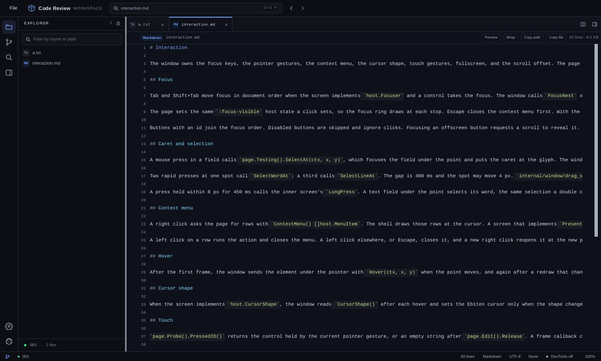

# own-code

A dark code viewer and review app. I copied it from `ownframe/examples/code-view` into this folder so it can grow as a separate app. The `ownframe` checkout stays untouched.



The screenshot shows the app with the explorer open and `interaction.md` in the editor. Token colors, line numbers, and the breadcrumb stay visible while reading.

## Run

The entry point is `cmd/own-code/main.go`. All app code lives in `internal/app/`, with its embedded `components/`, `fixtures/`, and `testdata/` trees alongside it. `go.mod`, `docs/`, `install.sh`, and this file stay at the root. Builds resolve `ownframe` through the `../ownframe` sibling checkout in `go.mod`; `vendor/` is local-only and never committed.

You need Go 1.26 and a sibling `ownframe` checkout for the local `replace`.

```sh
cd /home/chinmay/ChinmayPersonalProjects/own-code
go mod tidy
go run ./cmd/own-code
```

Point it at another directory:

```sh
go run ./cmd/own-code -root /path/to/repo
go run ./cmd/own-code -root /path/to/monorepo -files 25000
```

Useful flags:

```sh
go run ./cmd/own-code -web
go run ./cmd/own-code -web -addr 127.0.0.1:8145
go run ./cmd/own-code -dev
go run ./cmd/own-code -perf=false
go run ./cmd/own-code -chrome=false
```

The viewer opens the current directory by default and reads the working tree diff at startup. The default window is 1500x900 with a minimum of 840x700. `F12` opens the developer dock. The scan stops at 10,000 files unless `-files` raises the budget, and the status bar reports when the limit hits. `internal/app/testdata/sample` is the deterministic fixture the tests use. `-web` serves the same tick, key, wheel, click, and live frame loop in a browser. It does not start the file watcher.

On Windows, a workspace under a WSL network path (`\\wsl$\...`) hands off into WSL through `wsl.exe` with a translated path, so scanning, git, and watching run on Linux. `-wsl=false` forces the native Windows build.

## Install

```sh
curl -fsSL https://raw.githubusercontent.com/chinmay-sawant/own-code/master/install.sh | sh
```

This builds from source and installs the binary to `$HOME/.local/bin/own-code`. To choose another prefix (the binary goes to `$PREFIX/bin`):

```sh
PREFIX=/usr/local curl -fsSL https://raw.githubusercontent.com/chinmay-sawant/own-code/master/install.sh | sh
```

Manual alternative (run it next to an `ownframe` checkout, since `go.mod`
points at `../ownframe`):

```sh
git clone https://github.com/chinmay-sawant/own-code.git
git clone https://github.com/chinmay-sawant/ownframe.git
cd own-code
go build -o own-code ./cmd/own-code
```

## Features

The app has an explorer tree with a file filter, language badges, and change letters. Folders show a right or down chevron. The header has a collapse all button. When the tree runs taller than the sidebar, the mouse wheel, a thin scrollbar, footer arrows, or the keyboard scroll it. Hover on a clipped row shows the full path in the status bar. Open folders pin as sticky headers. `Space` toggles the focused folder or opens the focused file. Right click gives Copy Path, Copy File, and Paste.

Tabs keep up to eight files and shrink names so all eight stay visible. Right click on a tab gives Close, Close Others, and Close All. The Working tree tab has its own close control, and closing it returns to the open file. Closing the last file tab shows the welcome panel. The split button opens a second editor group with its own tab list. Both groups live in one window and share one page scroll.

Click in the source, or press `Ctrl+E`, to edit in place. The token colors, line numbers, gutter marks, caret, and selection stay on screen. `Ctrl+S` saves. The active tab marks a changed file with M, A, D, or U, and the status bar shows an unsaved dot. Arrow keys, Home and End, Page Up and Page Down, Enter, Backspace, Delete, word delete, cut, paste, undo, and redo work in the buffer. `Ctrl+A` selects all, and `Ctrl+C` copies. The sample workspace is read only, and Save reports that. A disk workspace writes the file and refreshes its tokens.

A changed file shows a gutter mark on each added, modified, or deleted line, plus a faint line tint. Click the mark to open a line card with old and new text. The card has up and down arrows that stop at the first and last change in the same file. A translucent bar at the bottom center steps through changed files with previous and next arrows, position, and add and delete counts. Click the file name to open it.

Source Control runs `git diff HEAD` plus untracked files at startup and on refresh, with a three second git budget. The drawer lists working tree files above a History pane. The History rail reads 20 recent commits at a time, draws a lane graph with up to six lanes, and loads larger pages on a background worker as you scroll past half the loaded rows, up to 500. Click a commit to load its first patch in the editor. Hover shows subject, body, author, and date in a card. Drag the divider to resize files against history. `Working tree` returns to the uncommitted diff. The branch picker lists local and remote branches without changing the checkout, filters by name, caches results for the session and across restarts, and `Follow HEAD` returns to the checked out branch. The bundled sample uses a fixed three commit history built from `internal/app/fixtures/sample.diff` and never runs git.

Quick open (`Ctrl+P`) starts with open tabs, then recents, then the first workspace files. Typing filters paths. The sidebar filter is separate and stays on the explorer. `Ctrl+F` finds in the active file with match count, case toggle, and next or previous with wrap. `Ctrl+Shift+F` searches workspace contents across scanned text files, skips binary and oversized files, caps one file at eight hits, and returns up to 200 matches. Enter opens the file at the source line.

Markdown preview (`Ctrl+Shift+V` or the Preview button) renders headings, paragraphs, lists, quotes, fences, tables, rules, bold, italic, inline code, links, structured HTML rows, and Mermaid flowcharts and sequence diagrams in fixed 20 px rows. `Source` returns to tokens. Tables wrap inside aligned columns. `script` and `style` contents are removed. Other Mermaid diagram types show a note plus source lines.

The highlighter covers Go, Python, JavaScript and TypeScript, Markdown, CSS, JSON, HTML, YAML, and shell. Other files open as plain text.

Details reads the active file, with language, line count, exact size, encoding, indentation, change status, and an outline. Click an outline row to jump to the line. In Source Control it follows the selected diff file. The status bar shows branch, change summary, active language or diff counts, devtools state, scan budget, rescan summaries, and unsaved files. Sessions persist recents, both tab lists, split, history ratio, details, dock state, wrap, preview, and diff mode under `ownframe/code-view/session-<hash>.json` in the user config directory. A desktop fsnotify watcher rescans the tree, reopens changed documents, and follows `.git/HEAD` and refs. Long lines soft wrap by default in files and diffs. `Z` or the Wrap chip toggles it.

## Keys

| Key | Action |
|---|---|
| **`Ctrl+P`** | Quick open |
| **`Ctrl+F`** | Find in the active file |
| **`Ctrl+Shift+F`** | Search workspace contents |
| **`Ctrl+E`** | Edit the active file |
| **`Ctrl+S`** | Save while editing |
| **`Ctrl+A`** | Select all in the edit buffer |
| **`Ctrl+C`** | Copy the edit selection |
| **`Ctrl+V`** | Paste a staged copy or clipboard file into the explorer folder |
| **`Ctrl+\`** | Split or close the second editor |
| **`M` or `Ctrl+Shift+V`** | Markdown preview |
| **`Z`** | Toggle soft wrap in files and diffs |
| **`Enter` `Space`** | Activate the focused control |
| **`1`** | Explorer |
| **`2`** | Source control |
| **`3`** | Details |
| **`F`** | Focus the sidebar file filter |
| **`Up` `Down`** | Scroll a row group |
| **`Page Up` `Page Down`** | Scroll a page |
| **`Home` `End`** | First or last row |
| **`R`** | Reload the open file, or refresh the diff |
| **`W`** | Close the active tab, or the Working tree tab in Source Control |
| **`S` `U`** | Split or unified diff |
| **`N` `P`** | Next or previous hunk |
| **`Esc`** | Close Details, the toast, search, or the edit buffer |

`F12` and `Ctrl+Shift+I` belong to the window and toggle the developer dock. `Tab` moves through id bearing controls. While the palette, content search, or branch picker is open, background controls get `tabindex="-1"`, so Tab stays inside the overlay.

## Files

All paths below are under `internal/app/`, except the entry point.

| File | Purpose |
|---|---|
| **`cmd/own-code/main.go`** | Flags, startup, window and watcher wiring |
|---|---|
| **`app.go`** | State, view assembly, windowing, tabs, modes |
| **`pane.go`** | Two group pane geometry and the second editor rows |
| **`split_ops.go`** | Split toggle and focus routing |
| **`edit_ops.go`** | Edit buffer, save, and dirty tracking |
| **`search_ops.go`** | Workspace content search panel |
| **`session.go`** | Session file load, save, sanitize |
| **`app_session.go`** | Restore and persist layout |
| **`actions.go`** | Click, filter, search, and keyboard routing |
| **`context_menu.go`** | Tab and explorer context menu rows |
| **`palette.go`** | Quick open rows, selection, and focus |
| **`markdown_preview.go`** | Rendered Markdown rows and source anchors |
| **`markdown_html.go`** | Structured HTML preview blocks and entities |
| **`markdown_mermaid.go`** | Flowchart and sequence diagrams |
| **`syntax.go`** | Shared lexer and the Go, Python, and JavaScript specs |
| **`syntax_markup.go`** | CSS, JSON, HTML, YAML, and shell |
| **`syntax_markdown.go`** | Markdown blocks and inline spans |
| **`diff.go`** | Unified diff parser, word emphasis, row builders |
| **`diff_wrap.go`** | Unified and split diff wrapping |
| **`workspace.go`** | Sample and disk scanning, file reads, limits |
| **`workspace_write.go`** | Save one file under the root |
| **`workspace_search.go`** | Content search engine |
| **`edit_buffer.go`** | Text editing model |
| **`selection_model.go`** | Selection ranges, word and line marks |
| **`text_edit.go`** | Caret keys, undo, clipboard, and snapshots |
| **`editor_group.go`** | One group tab list |
| **`rescan.go`** | Workspace delta and git metadata detection |
| **`outline.go`** | Details panel symbols |
| **`git.go`** | Live working tree changes |
| **`watch.go`** | Recursive fsnotify watcher, rescan, git refresh |
| **`branches.go`** | Local and remote branch list for the history picker |
| **`commits.go`** | Commit metadata and one file patches |
| **`commit_loader.go`** | Background patch worker |
| **`commit_graph.go`** | Commit lane graph layout |
| **`internal/app/components/`** | HTML fragments and stylesheets |
| **`docs/code-view.png`** | Screenshot used at the top of this file |
| **`internal/app/testdata/sample`** | Deterministic 17 file fixture for tests |
| **`internal/app/fixtures/sample.diff`** | Checked in diff for the sample workspace |

## Limits

- The two editor groups share one window and one page scroll. A split keeps both panes on the same row offset.
- Files over 512 KB and files with a NUL byte show a notice. A file over 20,000 lines keeps the first 20,000. A line over 32 KB shows a notice instead of opening.
- A diff over 512 KB, 20,000 lines, or one line over 32 KB renders one notice row. A commit patch that hits its 512 KB read cap shows the same notice.
- The scan skips `.git`, `node_modules`, `vendor`, build output, and binary extensions.
- There is no horizontal scroll. Files and diff cells soft wrap. `Z` turns wrap off and the diff clips with an ellipsis.
- The History pane loads 20 commits, then grows the page as the rail crosses half the loaded rows, up to 500. Patches load on a background worker.
- This app targets desktop. There is no phone layout or mobile path.
- The fsnotify watcher is desktop only. `-web` keeps the manual Refresh and `R` path.
- Quick open searches file names. `Ctrl+Shift+F` searches file contents.
- The Markdown preview uses fixed rows. It is an approximation, not a browser DOM. Mermaid covers basic flowcharts and sequence diagrams, not subgraphs.
- Gutter marks and line cards cover working tree changes only. A commit patch keeps its unified or split diff view.
- Editing is a simple buffer. It has no multi cursor, no language server, and no unsaved change prompt when a tab closes.
- Git ignored paths stay in the explorer as muted gray rows with an `IGNORED` badge. A skipped ignored directory gets one placeholder row.

## Tests

```sh
cd /home/chinmay/ChinmayPersonalProjects/own-code
go test -p 1 ./cmd/own-code
```

Capture review frames:

```sh
OWNFRAME_CODE_VIEW_SCREENSHOT=1 go test -run '^TestScreenshot$' ./cmd/own-code
```

PNGs land in `/tmp/opencode/code-view-shots/`: `explorer`, `preview`, `palette`, `changes`, `split`, `details`, `edit`, `inline-card`, `split-editor`, `commit-tip`, `search`, `scrolled`, `scrollrails`, `ignored`, and `welcome`. Nothing is added to this repo.

## Relation to ownframe

This folder started as a copy of `ownframe/examples/code-view`. That example remains the upstream reference. I did not move files out of `ownframe`, and I changed nothing there.

`go.mod` requires `github.com/chinmay-sawant/ownframe` at master commit
`f2f079065cfa` (pseudo-version `v0.0.3-0.20261030080535-f2f079065cfa`),
which has the `MenuItem` API this copy needs. No published tag has it yet.
The upstream module zip at that commit is too large to download, so the
build resolves `ownframe` through the local `replace` to `../ownframe`
instead. Keep an `ownframe` checkout next to this repo: `go build`,
`go vet`, and `go test` all need the sibling, and so does `go mod tidy`.
