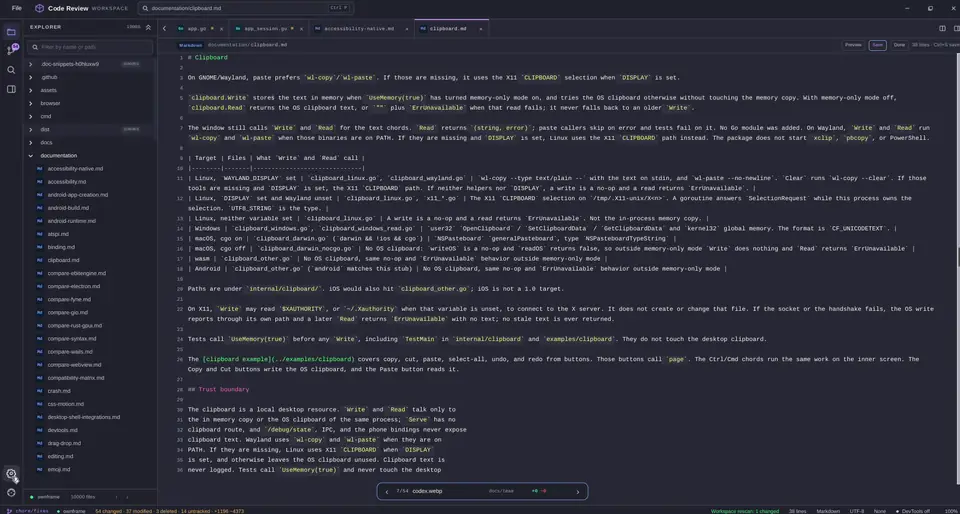

# own-code

own-code is a desktop app for reading code and reviewing diffs: explorer, in-place editor, unified and split diffs, git history, Markdown preview, and ten color themes.



A quick tour: explorer, editor, Source Control diff, and history.

## Run

The entry point is `cmd/own-code/main.go`. App code lives in `internal/app/` (app core), `internal/edit/` (text buffer + selection model), and `internal/wsl/` (WSL path/handoff helpers). The embedded `components/`, `fixtures/`, and `testdata/` trees live at the repo root and are served via the root `owncode` package (`assets.go`). `go.mod`, `docs/`, `install.sh`, `install-local.sh`, and this file stay at the root. Dependencies, including `ownframe`, resolve through the Go module proxy; `vendor/` is local-only and never committed.

You need Go 1.26 or newer. Dependencies download automatically.

```sh
cd /home/chinmay/ChinmayPersonalProjects/own-code
go mod tidy
go run ./cmd/own-code
```

Point it at another directory:

```sh
go run ./cmd/own-code -root /path/to/repo
go run ./cmd/own-code -root /path/to/monorepo -files 25000
```

Useful flags:

```sh
go run ./cmd/own-code -web
go run ./cmd/own-code -web -addr 127.0.0.1:8145
go run ./cmd/own-code -dev
go run ./cmd/own-code -perf=false
go run ./cmd/own-code -window-control=false
```

Launch the desktop window without holding the terminal:

```sh
own-code -d
```

`-d` (or `-detach`) re-execs the GUI in its own session, so closing the
terminal leaves it running. Its warnings and fatal errors append to
`own-code.log` in the OS cache directory (`~/.cache/own-code/own-code.log`
on Linux). At 1 MiB the next detached launch moves it to `own-code.log.1`
and starts a fresh log; only that one previous file is kept.

The viewer reopens the last opened project when `-root` is omitted and reads the working tree diff at startup. Pass `-root` explicitly to open somewhere else. The default window is 1500x900 with a minimum of 840x700. `F12` opens the developer dock. The scan stops at 10,000 files unless `-files` raises the budget, and the status bar reports when the limit hits. `testdata/sample` (embedded via root `owncode.SampleFiles`) is the deterministic fixture the tests use. `-web` serves the same tick, key, wheel, click, and live frame loop in a browser. It does not start the file watcher.

On Windows, a workspace under a WSL network path (`\\wsl$\...`) hands off into WSL through `wsl.exe` with a translated path, so scanning, git, and watching run on Linux. The folder browser detects WSL too: with WSL installed it offers Browse WSL files (distro list, then `\\wsl$\<distro>\...`) alongside This PC, and picking a WSL folder there, or typing a `\\wsl$\...` path, relaunches the companion inside WSL2 and closes the Windows window. `-wsl=false` forces the native Windows build. The WSL detect, path, and re-exec helpers live in `internal/wsl/` and are wired from `cmd/own-code/main.go` (startup) and the folder browser actions (runtime).

## Install

One command installs the matching prebuilt binary (Linux, WSL2, Ubuntu, or
macOS; amd64 or arm64, detected automatically) to
`$HOME/.local/bin/own-code`:

```sh
curl -fsSL https://raw.githubusercontent.com/chinmay-sawant/own-code/master/install.sh | sh
```

The installer downloads the latest GitHub Release asset and verifies its
SHA-256 against the release's `SHA256SUMS`. Set `OWN_CODE_VERSION=v0.0.1` to
pin a version. To choose another
prefix (the binary goes to `$PREFIX/bin`):

```sh
PREFIX=/usr/local curl -fsSL https://raw.githubusercontent.com/chinmay-sawant/own-code/master/install.sh | sh
```

Prefer `wget`? `wget -qO- <url> | sh` works the same.

### From this checkout

If you already have the repo, build the working tree (including uncommitted
changes) and install it without downloading a release:

```sh
./install-local.sh                      # -> ~/.local/bin/own-code
PREFIX=/usr/local ./install-local.sh    # -> /usr/local/bin/own-code
make install                            # same as the first command
```

It needs Go 1.26+. To
install an already-built binary instead of compiling:

```sh
./install-local.sh --binary ./own-code-linux-amd64
```

Manual alternative: grab your OS/arch file from the
[latest release](https://github.com/chinmay-sawant/own-code/releases/latest),
save it as `own-code` somewhere on your `PATH`, and `chmod +x` it.

Build from source instead (run it next to `ownframe` and `blinkless`
checkouts, since `go.work` and `go.mod` point at `../ownframe` and
`../blinkless`; only their Go sources are needed, so sparse checkouts keep
them small):

```sh
git clone https://github.com/chinmay-sawant/own-code.git
for repo in ownframe blinkless; do
  git clone --depth 1 --branch master --filter=blob:none --sparse \
    "https://github.com/chinmay-sawant/$repo.git"
  git -C "$repo" sparse-checkout set --no-cone \
    '/*.go' '/go.mod' '/internal/' '/css/' '/html/' '/layout/' '/markup/'
done
cd own-code
./install-local.sh
```

### Windows

One command installs the matching prebuilt binary from the latest GitHub Release
(amd64 or arm64, detected automatically, checksum verified) into
`%USERPROFILE%\.local\bin` and adds it to your user `PATH`, so `own-code`
runs from anywhere. From CMD:

```cmd
curl -fSL -o "%TEMP%\own-code-install.bat" https://raw.githubusercontent.com/chinmay-sawant/own-code/master/install.bat && "%TEMP%\own-code-install.bat"
```

Prefer a manual download instead? Grab your architecture's exe from the
[latest release](https://github.com/chinmay-sawant/own-code/releases/latest), save it as `own-code.exe` somewhere on
your `PATH`, and run `own-code`.

## Features

- Explorer tree with filter, language badges, change letters, and sticky folders. Right click gives Copy Path, Copy File, Paste, and Reveal in Finder, Explorer, or the Linux file manager.
- Unlimited tabs plus a split second editor group with independent scroll, click or `Ctrl+1`/`Ctrl+2` focus, a draggable divider, and close-one-side that merges tabs into the survivor. Single-click previews at the back of the strip (italic); double-click, `Enter`, `Ctrl+K`, or editing pins the tab.
- Click to edit in place with syntax colors, `Ctrl+S` saves. `Ctrl+A` select all, `Ctrl+C` copy, undo and redo.
- Gutter marks on changed lines with line cards, plus a bottom bar to step through changed files.
- Unified and split diffs with word emphasis, hunk stepping (`N`/`P`), and per-block revert.
- Source Control: working tree plus a history lane graph that loads in pages. Branch picker without changing checkout.
- Quick open (`Ctrl+P`), in-file find (`Ctrl+F`) and replace (`Ctrl+H`), workspace content search (`Ctrl+Shift+F`) and replace (`Ctrl+Shift+H`).
- Go to definition (`Ctrl+D`, or `Ctrl+Click`) also works from the read-only token view: `Ctrl+D` resolves the identifier under the mouse pointer. Format on save runs `gofmt` for `.go` and `prettier` (when on `PATH`) for web files; configure or disable it with the `format` block in `settings.json` (`{"format": {"onSave": false, "formatters": {".py": {"command": "black", "args": ["-q", "-"]}}}}`). Missing tools are skipped. The editor draws indent guides and highlights the bracket pair at the caret.
- Go to line (`Ctrl+G` with `:<line>[:<col>]`), go to symbol in the active file (`Ctrl+Shift+O`), bracket jump and select (`Ctrl+M`, `Ctrl+Shift+M`).
- Editing helpers: auto-indent on `Enter`, toggle line comment (`Ctrl+/`), indent and outdent (`Tab`, `Shift+Tab`).
- Markdown preview (`Ctrl+Shift+V`) with tables and Mermaid flowcharts, in fixed rows.
- Image viewer for PNG, JPEG, GIF, and SVG files, scaled to fit the editor pane in both split groups.
- Highlighting for Go, Python, JavaScript/TypeScript, Markdown, CSS, JSON, HTML, YAML, and shell.
- Details drawer with outline, status bar, persisted sessions, soft wrap (`Z`), desktop file watcher.
- Language servers (optional, from `PATH`): diagnostics with squiggles, a workspace Problems panel, hover cards, and Go to Definition / Declaration / Type Definition (with automatic fallback to the local symbol index when no server responds), plus completion (`Ctrl+Space` and server trigger characters such as `.`; `Tab`/`Enter` accepts, typing filters), Find References (`Shift+F12`, shown in the workspace search panel), Rename Symbol (`F2`, previewed in a confirm dialog), document symbols for the outline and `Ctrl+Shift+O`, workspace symbols (`Ctrl+T`, local index fallback), and server progress in the status bar (for example `gopls: Indexing 42%`). Each is also a `LSP:` palette command. Rest the pointer on an identifier for about 400 ms to see the server's hover text as Markdown; moving off the token, scrolling, editing, switching tabs, or `Esc` closes it. Defaults: `gopls`, `typescript-language-server` (`.ts .tsx .js .jsx .mjs .cjs`), `pyright-langserver`, `rust-analyzer`, `clangd`, `vscode-html-language-server` (`.html .htm`), `vscode-css-language-server` (`.css .scss .less`), `vscode-json-language-server` (`.json .jsonc`), `marksman` (`.md .markdown`), and `yaml-language-server` (`.yaml .yml`). For the web servers: `npm i -g typescript-language-server vscode-langservers-extracted yaml-language-server`. `typescript-language-server` also needs TypeScript 5 or 6 in the project (`npm i -D typescript` in the workspace) or an `initializationOptions.tsserver.path`; a global TypeScript 7 has no `tsserver.js` and the server fails to start. Override a server, or add one, in the `lsp` block of `settings.json` (`command`, `args`, `extensions`, `languages`, `initializationOptions`, `disabled`). A missing binary shows one install hint, never an error loop. Server processes cost memory beyond the own-code process.
- Command palette (`Ctrl+P`, then `>`): fuzzy match with highlighted characters, right-aligned keybindings (they follow your rebinds), and recently used commands pinned on top. `Task: Run Task…` lists Makefile targets, `package.json` scripts (npm/pnpm/yarn by lockfile), `go test/build/vet ./...` and cargo tasks, and types the chosen one into the integrated terminal; only names matching `[A-Za-z0-9_.:@-]` are offered, so a hostile Makefile cannot inject shell text. Git commands: `Stage Hunk at Cursor`, `Unstage Hunk at Cursor`, `Stash Changes` (tracked files only), `Apply Stash…` (applying keeps the stash entry), and `Compare Refs…` (`>compare main feature/x` or `>diff v1..v2` shows the two-ref diff in the Source Control branch view). Settings has a Language servers tab: a master switch, a per-server enable toggle, and live status (running, ready, failed, not installed with an install hint).
- Embedded terminal with session tabs, a resizable bottom panel, and an installed-shell picker. See [docs/terminal.md](docs/terminal.md).
- Git merge conflict resolver with conflict badges, Current/Incoming/Both/Compare actions, conflict navigation, and explicit staging. See [docs/merge-conflicts.md](docs/merge-conflicts.md).

## Versus VS Code

VS Code is a general IDE and plugin host on Electron. own-code is a single-purpose reader and review tool.

| | VS Code | own-code |
|---|---|---|
| **Runtime** | Electron shell with 15+ helper processes | One static Go binary, no runtime to install |
| **Idle memory** | ~1,166–1,440 MB RSS across those processes | ~200 MB RSS, one process |
| **Startup work** | Background indexing over seconds | One scan up to the file budget, then it idles |
| **Account and extensions** | Account, settings sync, extension host | None. No login, no plugins |
| **Scope** | Authoring, debugging, extensions | Reading, review, diff, Markdown preview |

The VS Code figures are px0's published head-to-head measurements, included for scale. own-code's ~200 MB idle RSS was measured on this machine under Xvfb on a small workspace. The shipped binary is ~43 MB.

### Same-kernel cost: ownframe vs px0

own-code runs on ownframe, so the engine numbers below apply to it directly. Measured on one kernel with PSS on both sides, px0 v0.1.20 serving and Chrome open on its tab, sampled 40 seconds each.

| Component | ownframe | px0 v0.1.20 |
|---|---|---|
| **Window or tab renderer** | 231–257 MB whole process | 145–164 MB tab renderer |
| **px0 server** | In-process | 41–44 MB |
| **Browser process** | 0 | 142 MB |
| **GPU process** | 0 | 205 MB |
| **Zygotes and utilities** | 0 | 84 MB |
| **Total local PSS** | 231–257 MB | 621–660 MB |
| **Summed RSS, for reference** | Same as PSS | 1,071–1,104 MB, double counts shared pages |
| **Process count** | 1 | 11 |

Chrome's browser and GPU processes alone, 347 MB PSS, are larger than the entire ownframe app. For total local memory, ownframe wins by about 2.6x. For a remote or headless host, px0 is slightly ahead: its server was 24 MB idle and 41–44 MB while navigating, against 52 MB for ownframe's `-web` server on the same workspace. For the tab alone, px0's renderer is lighter, but the browser takes that back once its processes are counted. About 89 MB of the ownframe figure is WSL2 graphics driver code, so on a host with a hardware driver the gap grows, not shrinks.

## Keys

| Key | Action |
|---|---|
| **`Ctrl+P`** | Quick open |
| **`Ctrl+G`** | Go to line (`:<line>[:<col>]`) |
| **`Ctrl+Shift+O`** | Go to symbol in the active file |
| **`Ctrl+M`** | Jump to the matching bracket (`Ctrl+Shift+M` selects to it) |
| **`Ctrl+/`** | Toggle line comment while editing |
| **`Ctrl+Shift+Up` `Ctrl+Shift+Down`** | Move the line or selected lines up or down while editing |
| **`Ctrl+Shift+D`** | Duplicate the line or selected lines |
| **`Ctrl+Shift+K`** | Delete the line or selected lines |
| **`Ctrl+J`** | Join the line with the next (or the selected lines) |
| **`Tab` `Shift+Tab`** | Indent or outdent while editing |
| **`Ctrl+F`** | Find in the active file |
| **`Ctrl+H`** | Find and replace in the active file (`Enter` replaces next, `Ctrl+Enter` replaces all) |
| **`Ctrl+Shift+F`** | Search workspace contents |
| **`Ctrl+Shift+H`** | Search and replace across the workspace (per-file checkboxes, `Ctrl+Enter` confirms) |
| **`Alt+C` / `Alt+R` / `Alt+W`** | Match case, regular expression, whole word in the find or search bar |
| *Pointer rests ~400 ms on an identifier* | Hover card from the language server (`Esc`, scrolling, or moving away closes it; not rebindable) |
| **`Ctrl+E`** | Edit the active file |
| **`Ctrl+S`** | Save while editing |
| **`Ctrl+A`** | Select all in the edit buffer |
| **`Ctrl+C`** | Copy the edit selection |
| **`Ctrl+V`** | Paste a staged copy or clipboard file into the explorer folder |
| **`Ctrl+\`** | Split or close the second editor |
| **`Ctrl+1` `Ctrl+2`** | Focus the left or right editor |
| **`F6`** | Cycle the focused editor pane while split |
| **`M` or `Ctrl+Shift+V`** | Markdown preview |
| **`Z`** | Toggle soft wrap in files and diffs |
| **`Enter` `Space`** | Activate the focused control |
| **`1`** | Explorer |
| **`2`** | Source control |
| **`3`** | Details |
| **`F`** | Focus the sidebar file filter |
| **`Up` `Down`** | Scroll a row group |
| **`Page Up` `Page Down`** | Scroll a page |
| **`Home` `End`** | First or last row |
| **`R`** | Reload the open file, or refresh the diff |
| **`W`** | Close the focused pane's active tab, or the Working tree tab in Source Control |
| **`S` `U`** | Split or unified diff |
| **`N` `P`** | Next or previous hunk |
| **`Esc`** | Close Details, the toast, search, or the edit buffer |

`F12` and `Ctrl+Shift+I` belong to the window and toggle the developer dock. `Tab` moves through id bearing controls. While the palette, content search, or branch picker is open, background controls get `tabindex="-1"`, so Tab stays inside the overlay.

## Limits

- The two editor groups scroll vertically and horizontally on their own offsets, rails, and per-tab memory; click a pane or press `Ctrl+1`/`Ctrl+2` to focus it. The divider drags (arrow keys + `Home` when focused), and closing one side merges its tabs into the survivor unless dropped. The page spacer follows the taller pane.
- The split layout (open panes, focused side, divider ratio) persists per workspace in the session file; per-tab scroll offsets do not survive a restart.
- Text files over 512 KB and files with a NUL byte show a notice. A text file over 20,000 lines keeps the first 20,000. A line over 32 KB shows a notice instead of opening. Images preview up to 32 MB and 16 megapixels.
- A diff over 512 KB, 20,000 lines, or one line over 32 KB renders one notice row. A commit patch that hits its 512 KB read cap shows the same notice.
- The scan skips `.git`, `node_modules`, `vendor`, build output, and unsupported binary extensions. PNG, JPEG, GIF, and SVG files are scanned and open in the image viewer.
- Files and diff cells soft wrap by default, so there is nothing to scroll sideways. `Z` turns wrap off; the editor and diff then scroll horizontally (wheel or keyboard, per editor group, clamped to the longest line) and diff cells can also clip with an ellipsis.
- The History pane loads 20 commits, then grows the page as the rail crosses half the loaded rows, up to 500. Patches load on a background worker.
- This app targets desktop. There is no phone layout or mobile path.
- The fsnotify watcher is desktop only. `-web` keeps the manual Refresh and `R` path.
- Quick open searches file names. Paste an absolute path to open that file, even outside the workspace. `Ctrl+Shift+F` searches file contents.
- In-file replace (`Ctrl+H`) and workspace replace (`Ctrl+Shift+H`) share one matcher: literal, `Aa` case, `.*` regex (Go RE2, `$1`/`$name` in the replacement), and whole-word toggles. Invalid patterns show an inline error and disable Replace. In-file replace-all is one undo step; workspace replace-all confirms first (`Replace N in K files?`), skips binary, oversized, ignored, dirty, and unreadable files, preserves CRLF, refuses past 2000 matches, and offers one explicit Undo replace (not `Ctrl+Z`).
- The Markdown preview uses fixed rows. It is an approximation, not a browser DOM. Mermaid covers basic flowcharts and sequence diagrams, not subgraphs.
- Gutter marks and line cards cover working tree changes only. A commit patch keeps its unified or split diff view.
- Editing is a simple buffer. It has no multi cursor. Language-server support covers diagnostics, hover, and go to definition / declaration / type definition so far plus completion, references, rename, and symbols (no signature help, code actions, or snippet tab-stop cycling yet); hover works in token view and edit mode in either editor group, but not in Markdown preview, diffs, or the merge view, and a token split across a soft-wrap boundary anchors the card at its row start. Dirty tabs and explorer rows carry a dot; closing one asks Save / Don't Save / Cancel. Auto-save (Settings: Off, After delay with a 250–5000 ms debounce, On focus change) persists per workspace. It never writes merge results or the sample workspace, and the delay skips large files.
- Git ignored paths stay in the explorer as muted gray rows with an `IGNORED` badge. A skipped ignored directory gets one placeholder row. Expanding an ignored folder loads real children with a spinner; empty stays a placeholder with no spin loop.
- Settings (gear icon) roam in `settings.json` beside the per-workspace sessions: theme, base font (8–24px), interface zoom (50–300%), per-view editor/terminal overrides, keymap diffs, scan/search exclude globs, and desktop frame rate (`maxFps`: 60/120/144/240, -1/0 uncapped default). Precedence is session > settings > builtin for theme/zoom/font, and CLI `--fps` > settings > default (uncapped) for frame rate: a restored session overrides only the fields it stored, and every gesture writes both files. The status chip (`110% · 12px`) opens Appearance. Frame-rate changes apply on restart; the Frame tab shows FPS (presents, the FE number), TPS (hotter app rate at cap+20 when capped), MaxFPS, Present FPS, and Presents.
- `-files N` sets the scan budget (default 10000): an explicit N runs a full walk, otherwise startup opens lazily. `-fps N` sets the desktop present cap (60/120/144/240, -1/0 uncapped default; Updates run at cap+20 when capped, idle still parks, no VSync). Lazy never sets a scan budget; per-operation caps apply instead: 2000 children per folder (+ "N more…" row), Quick Open 8 rows / 750 ms disk timeout, content search 200 hits / 8 per file / 512 KB, all cancellable with Busy + Note and stale-drop. Scan excludes (`**/coverage/**`, `*.log`, trailing `/` for folders) hide files from the tree and search at walk time; search excludes plus ignored files (unless toggled) skip content search with an "N files skipped" note. Invalid globs are rejected in red and never abort a scan. Overbroad edits (over half, or all, files hidden) need a confirm.
- Keyboard shortcuts are rebindable in Settings → Keyboard (diffs only; Reset restores defaults). `F12`/`Ctrl+Shift+I` stay fixed for the developer dock. Terminal-owned chords (`Ctrl+C/V/X/Z/Y`) and single letters need a confirm; conflicts offer Swap/Replace/Cancel.

### How VS Code handles the same limits

own-code reads the root directory at startup and tokenizes only opened files (up to 512 KB / 20,000 lines / 32 KB per line), so its caps are explicit. VS Code instead defers the work.

| Area | own-code | VS Code |
|---|---|---|
| **Explorer tree** | Lazy by default: ReadDir(root) only at startup; folders load async on expand with spinner/retry, 2000 per-dir cap + "more…" row | Lazy reads: folders load only when expanded, no full tree walk at startup |
| **Quick open and search** | Streaming ripgrep from disk (respects ignores, no --no-ignore) covering unexpanded folders; caps 200 hits / 8 per file / 512 KB; loaded-only fallback notes scope | Out-of-process ripgrep streaming from disk, respecting ignores and excludes |
| **File watching** | Watches root + loaded/expanded dirs + git metadata (well under 2,000); targeted dir reloads, lazy-preserving rescan | Native recursive watchers, skipping `node_modules` and `.git/objects` |
| **Large files** | Skips files over 512 KB or 20,000 lines with a notice row | Piece Tree buffer; above roughly 20–50 MB it drops tokenization, minimap, and language features and shows plain text |

## Tests

```sh
cd /home/chinmay/ChinmayPersonalProjects/own-code
go test -p 1 ./...
```

Capture review frames:

```sh
OWNFRAME_CODE_VIEW_SCREENSHOT=1 go test -run '^TestScreenshot$' ./internal/app
```

PNGs land in `/tmp/opencode/code-view-shots/`: `explorer`, `preview`, `palette`, `changes`, `split`, `details`, `edit`, `inline-card`, `split-editor`, `commit-tip`, `search`, `scrolled`, `scrollrails`, `ignored`, and `welcome`. Nothing is added to this repo.

Made with ownframe.
